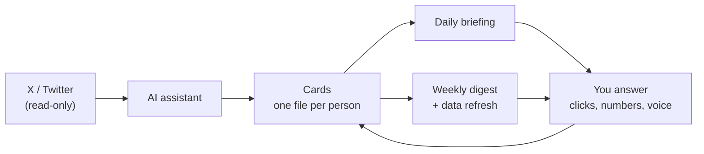

# xGrok network: People CRM for X

**A personal card file of your network on X (Twitter), kept up to date by your AI assistant. Built for and tested with Grok Bot as the main agent.**
You answer a few short questions, mostly with clicks. The assistant does the reading, sorting, and remembering. No code, read-only on X.

## Install in one sentence

- **Easiest:** open the xGrok network bot template link (coming soon) and the new bot walks you through setup.
- **Or tell your Grok Bot:** "Install the skill from https://github.com/azkian1/xGrok-network and set up my network CRM."

The bot reads [SKILL.md](SKILL.md), asks you a few questions (niche, goals, priority people, language, when to send briefings), builds your base, and creates the routines. No copying files or prompts.

---

## Why: your network is an asset

Most people grow their network by accident: they follow whoever shows up in the feed, forget who is who, and only reach out when they need something. This kit is built on the opposite idea. A few principles:

1. **Build your network on purpose.** Your network is an asset, like skills or savings. It compounds when you tend it, and it decays quietly when you don't.
2. **Your goals decide who matters.** Who is important depends on what you are trying to do, not on follower counts. The kit starts by asking about your niche and goals, and ranks people by those answers.
3. **Know who is who.** Some people connect others, some hold knowledge and spot signals early, some bridge into other niches. Each one matters for a different reason. The kit records why each person matters to you (value and groups). Explicit roles are on the roadmap.
4. **Weak ties bring new opportunities.** New ideas, clients, and collaborators usually come from people you barely know, not from your inner circle. That is why the kit tracks people who engage with you, even if you don't follow them.
5. **Keep in touch before you need anything.** A short reply every few weeks keeps a relationship alive. Showing up for the first time with a request does not work. The kit shows you whom you haven't touched for a while.
6. **Give before you ask.** A useful reply, a share, an introduction. The kit suggests what to write about. It never writes for you.
7. **Watch for early signals.** When a quiet account suddenly starts posting again, something is happening in your field. The kit keeps a cheap watchlist for exactly that.
8. **Quality over quantity.** Dead and irrelevant follows drown out the people who matter. Prune them on a regular basis.
9. **Write it down.** How you met, what you agreed on, who works with whom: memory fades, notes don't. Each person gets a card.

## What it is

People CRM is a set of plain Markdown files: rules, templates, and prompts. You hand it to an AI assistant that can read X and run scheduled tasks. The assistant creates a small card for every account you follow, with who they are, why they matter to you, your history together, and what to do next. From then on it keeps those cards current and sends you a short morning briefing and a weekly digest. Your base is a folder of Markdown files that belongs to you.

## What you get

- **Daily briefing.** One short message, and only when there is a reason to send one. It lists sleeping accounts that woke up, 1–3 people worth talking to today along with an idea of what to say, new engaged people, a few unclear accounts to sort, and one question of the day. If nothing is new, there is no message.
- **Weekly digest with improvement questions.** The strongest posts from your priority people, sleeping accounts that woke up, top engaged people, and next week's queue. It ends with 3–5 click-to-answer questions that sharpen the base over time.
- **Weekly data refresh.** Follows, followers, bios, follower counts, and activity are re-read in cheap batches, and changes are reported in one line.
- **Cleanup and quarantine.** Dead and useless follows go into a quarantine list. You unfollow from that list yourself, and the cards are archived, not deleted.
- **Watchlist of sleeping accounts.** Quiet accounts whose return would be news, like a former opinion leader, a paused project, or an old competitor, get checked every day with one batched request.
- **Engaged layer.** People who reply to or quote you, split into "substantive" and "wow". The best ones get suggested for a full card.
- **Touch history.** Every reply, quote, mention, and (if you paste it in) DM between you and a person is logged on their card, along with a `last_touch` date.
- **Priority queue.** A short weekly list of people worth engaging with, scored by why they matter to you, your goals, and how long it has been since you last talked.

## How it works



The assistant reads X, writes and updates the cards, and builds the briefings from them. Each answer you give goes back into the cards, so the next briefing is a little better.

## Manual setup (any AI assistant)

1. **Get the kit.** Copy `CONFIG.example.md` to `CONFIG.md` and fill in your X handle. Everything else has sensible defaults.
2. **Start the setup.** Open a chat with your assistant, attach the kit files (or link to this repo), and paste the setup prompt from [SETUP.md](SETUP.md#4-setup-prompt).
3. **Answer the onboarding questions.** The assistant asks six short questions: your niche, your goals for your network (ideas, collabs, audience, or just reading), what you want to grow, which people matter most, the language, and **when you want your briefings** (daily time and timezone, weekly day and time; defaults are 09:00 daily and Sunday 18:00).
4. **Sort only the unclear cases.** The assistant creates cards for everyone you follow and sorts the obvious cases on its own (official accounts, long-silent accounts, look-alikes). You only see the unclear ones, in batches, and answer in a few words or clicks. Suggestions sit in separate fields until you confirm them. You also get one list of long-quiet accounts to clean up (if nobody crosses the hard silence threshold, you still see the quietest ones).
5. **Turn on the routines.** Paste [routine-prompt.md](routine-prompt.md). The assistant creates the daily briefing and the weekly digest at the times you chose.
6. *(Optional)* **Put the base on GitHub and open it in Obsidian.** See [Your base on GitHub and in Obsidian](#your-base-on-github-and-in-obsidian) below.

Most of this happens in the background: the first build takes 20–60 minutes, while your own part takes about 5.

## What a day looks like

```text
Good morning
🔔 @old_founder woke up after 14 months of silence: "We're back, and building…" → link
💬 Who to talk to today:
   1. @indie_builder: your niche, 45 days since your last reply → their new post
      Idea: ask how they cut the onboarding to one screen
   2. @former_colleague: you noted "worked together on the launch", never touched on X
🙋 New engaged: @thoughtful_reader, 3 substantive replies this month. Create a card?
❓ Unclear, answer by number:
   1. @some_account: design tools newsletter → suggest: ideas / just read
   2. @another_one: no posts in 9 months → suggest: quarantine
🃏 Question of the day: Which of these three topics should rank higher next week? [A] [B] [C]
```

You reply with something like "1 ok, 2 quarantine, card yes", by voice if you like. Strong posts from priority people wait for the weekly digest, which keeps the morning to a short action list.

## Privacy and safety

- **Read-only on X.** The assistant never posts, replies, likes, reposts, follows, unfollows, or sends DMs. Every action on X is yours.
- **Suggestions, not ghostwriting.** It suggests whom to talk to and what about, but never sends text on your behalf.
- **Your base is private.** The cards contain personal notes about real people. Keep them in a private folder or a **private** repository. Never publish them.
- **You can review every change.** If you store the base on GitHub, the assistant can open a pull request with each day's changes, and merging it is how you approve them. See [GITHUB.md](GITHUB.md).
- **Low footprint.** It reads only fresh slices of posts and uses batched profile lookups, keeping within the rate limits of your X access.

## Your base on GitHub and in Obsidian

Your base is just a folder of Markdown files, so you can keep it in a private GitHub repository and read it as a notebook in [Obsidian](https://obsidian.md).

1. **Create an empty private repository** on GitHub, for example `people-base` (no README, no license).
2. **Give Grok Bot access to that one repo.** When you ask Grok Bot to push the base, it shows a card to connect GitHub. Choose "Only select repositories" and pick `people-base`.
3. **Tell Grok Bot:** "Push my People CRM base to <repo URL>." From then on it can commit changes there, or open a pull request with each day's changes so you approve them with a merge (see [GITHUB.md](GITHUB.md)).
4. **Connect Obsidian.** Install the community plugin **Obsidian Git**, clone your private repo into a vault (on desktop it needs Git installed and a GitHub personal access token or SSH key for a private repo), and turn on auto-pull. Your cards then appear as notes: one note per person, with `INDEX.md`, `QUEUE.md`, and `WATCHLIST.md` as hub pages.
5. **Edit in either place.** Notes you add in Obsidian are pushed back by the plugin, and Grok Bot reads them on its next run. Your manual edits always win over its guesses.

Keep the repository private: the cards contain personal notes about real people.

## Files

| File | What it's for |
|---|---|
| [README.md](README.md) | This overview |
| [SKILL.md](SKILL.md) | The installable skill: what a Grok Bot does when you say "install this" |
| [SETUP.md](SETUP.md) | Step-by-step setup, the onboarding questions, the setup prompt, rate-limit rules, FAQ |
| [CONFIG.example.md](CONFIG.example.md) | All settings in one place: about you, schedule, values, next steps, groups, auto-rules, queue, engaged, digest |
| [TEMPLATE-card.md](TEMPLATE-card.md) | The person card template, with a legend for every field |
| [TEMPLATE-lists.md](TEMPLATE-lists.md) | What the weekly queue (`QUEUE.md`) and the engaged list (`ENGAGED.md`) look like |
| [routine-prompt.md](routine-prompt.md) | Onboarding, the daily briefing routine, and the weekly digest (with the data refresh and improvement questions) |
| [PRINCIPLES.md](PRINCIPLES.md) | The design decisions and the reasons behind them |
| [GITHUB.md](GITHUB.md) | Keeping your base in a private GitHub repo and growing it with pull requests |
| [gitignore.example](gitignore.example) | A `.gitignore` for your base repo (keeps caches and raw dumps out) |
| [LICENSE](LICENSE) | MIT |

The assistant builds your base (in a separate folder) from these templates:

| Base file | Contents |
|---|---|
| `@handle.md` | One card per person you follow |
| `INDEX.md` | One line per card: handle, group, value, next step |
| `FOLLOWERS.md` | Followers you don't follow back, one line each |
| `QUARANTINE.md` | Candidates to unfollow, with reasons |
| `WATCHLIST.md` | Sleeping accounts and the ID of their latest post |
| `QUEUE.md` | This week's priority queue |
| `ENGAGED.md` | People who engage with your posts |
| `bots/`, `_unfollowed-archive/` | Likely bots, and cards for accounts you unfollowed |
| `_review-log.json`, `_questions-log.json` | Who and what has already been asked, so nothing repeats |
| `_state.json` | since_ids, last run, reads used, and the full stored follow list |
| `_anchors.json` | latest post ids for the watchlist and the weekly digest |
| `_build-log.md` | the first-build log (reads, timing, counts) |

## Requirements

- **Grok Bot**, the main agent this kit is built for and tested with: it reads X, keeps files on its own computer, runs scheduled routines, connects to GitHub, and makes clickable pages. Any other AI assistant that can read X (profiles, posts, search, follow lists), store files, and run scheduled tasks can work too, with small changes to the prompts.
- *Nice to have:* an assistant that can make a web page or a table with buttons, because clicking is faster than typing. Without one, everything still works in chat.
- *Optional:* a private GitHub repository for the base, with history and pull-request review, and [Obsidian](https://obsidian.md) with the Obsidian Git plugin to browse and edit the cards as notes.

The kit is written in English. Your base can be in any language: set `language` in `CONFIG.md`, and the assistant will write notes and briefings in that language.

## FAQ

**Do I need to know how to code?** No. You copy one file, paste two prompts, and answer questions.

**Will it unfollow people or reply for me?** No. It only reads X. It gives you a list of links, and you do the unfollowing and replying yourself.

**How much does it read from X?** Very little after the first build. The daily briefing usually takes 5–15 reads. A first build of 50 follows took about 55 reads and about 11 minutes; roughly 400 cards cost about 300–350 reads. Each X call returns at most 25 results, and large responses may be truncated. You set a hard limit with `daily_read_budget` (on Grok Bot's X tools: about 30 reads per minute, 1000 per day).

**I'm not in tech. Does it fit my field?** Yes. Groups, niches, and values are yours to define. `CONFIG.example.md` has examples for design, writing, founders, science, marketing, and more.

**What if the assistant classifies someone wrong?** Tell it ("I know this person", "3 is a friend"). Your corrections override its guesses and are never overwritten.

## Roadmap

- **Network roles.** Mark people as *connectors* (who link others), *knowledge holders* (who spot signals first), and *bridges* (who link you to other niches). This needs a who-talks-to-whom graph, which is expensive to read, so it may start with only the clearest cases.
- **Follows of your priority people.** See whom your key people started following. This is expensive on X, so if it ships it will cover 5–10 people once a week.
- **Cluster visualization.** A simple picture of your network by group and value, and later, with roles, where the gaps are.

See [PRINCIPLES.md](PRINCIPLES.md#next-roadmap) for the smaller items.

## License

MIT, by [@azaticus](https://x.com/azaticus). See [LICENSE](LICENSE). Use it, fork it, adapt it to your niche.

## Contributing

Issues and pull requests are welcome, especially:
- niche examples for `CONFIG.example.md` (groups, values, auto-rules for your field);
- cheaper ways to read X;
- translations of the prompts.

Keep the core rules intact: read-only on X, the person decides, and nobody's personal data in this repo. All examples must use fictional handles.
